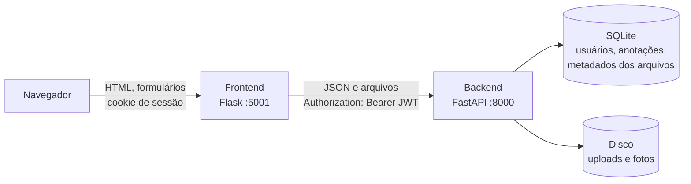

# MyFiles

Aplicação web para guardar e visualizar arquivos de mídia (imagens, vídeos e
áudios), com cadastro de usuários, foto de perfil, anotações e gráficos.

O sistema é formado por duas aplicações que trabalham juntas:

| Aplicação | Pasta | Tecnologia | Papel | Documentação |
|---|---|---|---|---|
| **Backend** | [`back/`](back/) | FastAPI + SQLAlchemy + SQLite | API REST: usuários, autenticação JWT, anotações, arquivos e banco de dados | [back/README.md](back/README.md) |
| **Frontend** | [`front/`](front/) | Flask + Jinja2 + Bootstrap | Interface web que o usuário acessa e que consome a API | [front/README.md](front/README.md) |

## Como as partes se integram



1. O usuário acessa **somente o frontend**.
2. No login, o frontend obtém um **token JWT** do backend e o guarda na sessão.
3. A cada página, o frontend chama a API com esse token e monta o HTML com a resposta.
4. Imagens, vídeos e áudios também passam pelo frontend, que os busca no
   backend e os repassa ao navegador. O backend pode ficar numa rede interna.
5. O backend valida o token, garante que cada usuário só acesse os próprios
   dados e grava tudo no SQLite e no disco.

---

## Executando a aplicação integrada

Há duas formas de rodar. Em ambas, a aplicação fica em
**http://localhost:5001** e a documentação da API em
**http://localhost:8000/docs**.

### Opção A: com Docker (recomendada)

São dois containers: **`myfiles-back`** (API + banco SQLite) e
**`myfiles-front`** (interface web). É preciso ter o Docker com o Compose v2.

```bash
git clone https://github.com/armandossrecife/myfiles.git
cd myfiles
cp .env.example .env            # opcional: chaves secretas e usuário inicial
docker compose up --build -d    # constrói as imagens e sobe os dois containers
docker compose ps               # aguarde os dois ficarem "(healthy)"
```

Abra http://localhost:5001 e entre com o usuário inicial do `.env`
(`armando` / `armando123` no exemplo) ou crie uma conta.

Para parar: `docker compose down` (os dados ficam no volume). Para apagar os
dados também: `docker compose down -v`.

O passo a passo completo, com backup, logs, execução numa instância EC2 e
solução de problemas, está em **[docs/EXECUCAO_DOCKER.md](docs/EXECUCAO_DOCKER.md)**.

### Opção B: sem Docker (desenvolvimento)

Requer Python 3.12. Use dois terminais, a partir da raiz do repositório.

**Terminal 1, backend:**

```bash
cd back
python3 -m venv venv && source venv/bin/activate
pip install -r requirements.txt
export MYFILES_ADMIN_USERNAME=armando MYFILES_ADMIN_PASSWORD=armando123 MYFILES_ADMIN_EMAIL=armando@ufpi.edu.br
./exec.sh                       # API em http://localhost:8000
```

**Terminal 2, frontend:**

```bash
cd front
python3 -m venv venv && source venv/bin/activate
pip install -r requirements.txt
export MYFILES_BACKEND_URL=http://localhost:8000
./exec.sh                       # interface em http://localhost:5001
```

O backend precisa estar rodando antes de você usar o frontend. Os dados ficam
em `back/data/`.

### Primeiros passos na aplicação

1. **Entrar** ou **Criar conta**.
2. **Arquivos**: envie um JPG, PNG, MP4 ou MP3. Clique no nome para ver a
   imagem ou tocar o vídeo/áudio, baixar ou excluir.
3. **Anotações**: crie, edite e exclua textos curtos.
4. **Perfil** (clique no seu nome): troque a foto.
5. **Linha do tempo** e **Tarefas**: gráficos de demonstração.

---

## Estrutura do repositório

```
myfiles/
├── back/                    # backend (API + banco)       -> back/README.md
├── front/                   # frontend (interface web)    -> front/README.md
├── integracao/              # testes ponta a ponta (frontend + backend reais)
├── docker/                  # Dockerfiles do backend e do frontend
├── docs/
│   ├── EXECUCAO_DOCKER.md   # guia passo a passo do Docker
│   └── diagrams/src/        # diagramas PlantUML (arquitetura e casos de uso)
├── docker-compose.yml       # orquestra os dois containers
├── .env.example             # modelo de configuração
├── requirements-dev.txt     # dependências para rodar todos os testes
└── .github/workflows/       # CI: roda os testes a cada push
```

## Testes

```bash
pip install -r requirements-dev.txt
(cd back && pytest)          # 46 testes da API
(cd front && pytest)         # 48 testes da interface (backend simulado)
(cd integracao && pytest)    # 6 testes ponta a ponta (frontend + backend reais)
```

Rode cada suíte a partir da sua própria pasta. O GitHub Actions
(`.github/workflows/testes.yml`) executa as três a cada push.

## Configuração

As duas aplicações são configuradas apenas por variáveis de ambiente. As
principais são:

| Variável | Aplicação | Para que serve |
|---|---|---|
| `MYFILES_SECRET_KEY` | backend | Assina os tokens JWT |
| `MYFILES_DATABASE_URL` | backend | Banco de dados (SQLite por padrão; aceita outros bancos do SQLAlchemy, como o RDS) |
| `MYFILES_STORAGE_DIR` | backend | Pasta dos arquivos enviados |
| `MYFILES_ADMIN_*` | backend | Usuário inicial opcional |
| `MY_SECRET_KEY` | frontend | Assina o cookie de sessão |
| `MYFILES_BACKEND_URL` | frontend | Endereço do backend |
| `MYFILES_MAX_UPLOAD_MB` | ambas | Tamanho máximo de upload |

As listas completas estão nos READMEs do [backend](back/README.md#configuração)
e do [frontend](front/README.md#configuração). No Docker, os valores vêm do
arquivo `.env` (veja `.env.example`).

## Limitações conhecidas

- A recuperação de senha mostra apenas uma orientação (não há envio de e-mail).
- O repasse de vídeo pelo frontend não suporta requisições `Range`, então o
  player não permite avançar para trechos ainda não baixados.
- Os gráficos usam dados de demonstração fixos.
- O SQLite atende bem um único container de backend. Para várias instâncias
  (por exemplo, com Auto Scaling), use um banco externo via
  `MYFILES_DATABASE_URL` e um armazenamento de arquivos compartilhado.
