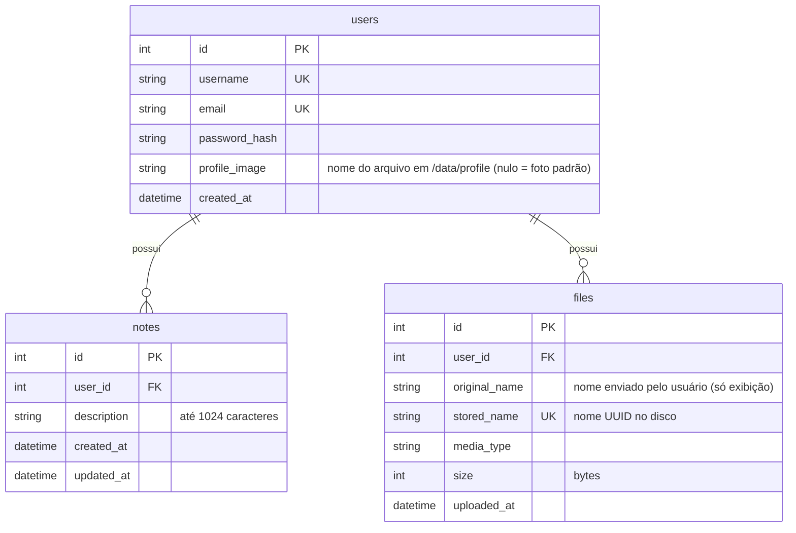

# MyFiles: backend (FastAPI + SQLite)

API REST do MyFiles. Cuida de usuários, autenticação, anotações, foto de perfil
e arquivos de mídia (imagem, vídeo e áudio). Guarda os dados em um banco
SQLite e o conteúdo dos arquivos no disco.

No Docker, **o backend e o banco rodam no mesmo container** (`myfiles-back`):
o SQLite é um arquivo (`/data/myfiles.db`) gravado no volume `myfiles-data`,
junto com os arquivos enviados.

- Documentação interativa (Swagger): http://localhost:8000/docs
- Verificação de saúde: http://localhost:8000/health

## Sumário

1. [Tecnologias](#tecnologias)
2. [Arquitetura em camadas](#arquitetura-em-camadas)
3. [Modelo de dados](#modelo-de-dados)
4. [Autenticação e autorização](#autenticação-e-autorização)
5. [Armazenamento de arquivos](#armazenamento-de-arquivos)
6. [Endpoints](#endpoints)
7. [Configuração](#configuração)
8. [Executando localmente](#executando-localmente)
9. [Executando no Docker](#executando-no-docker)
10. [Testes](#testes)

## Tecnologias

| Pacote | Uso |
|---|---|
| FastAPI 0.165 + Uvicorn | Framework web e servidor ASGI |
| SQLAlchemy 2.1 | ORM e acesso ao banco |
| SQLite | Banco de dados (arquivo único) |
| Pydantic 2 | Validação dos dados de entrada e formato das respostas |
| PyJWT | Geração e validação dos tokens de acesso |
| bcrypt | Hash das senhas |
| python-multipart | Recebimento de uploads (`multipart/form-data`) |

Versões exatas em [`requirements.txt`](requirements.txt).

## Arquitetura em camadas

```
back/
├── main.py                 # ponto de entrada: app = create_app()
├── api/
│   ├── main.py             # fábrica: cria pastas, tabelas, rotas e o usuário inicial
│   ├── config.py           # Settings lidas das variáveis de ambiente
│   ├── modelos.py          # tabelas (SQLAlchemy)
│   ├── entidades.py        # esquemas de entrada/saída (Pydantic)
│   ├── banco.py            # engine, sessão por requisição e DAOs
│   ├── seguranca.py        # bcrypt, JWT e dependências de autenticação/autorização
│   ├── armazenamento.py    # tipos de mídia aceitos e gravação segura no disco
│   ├── static/default.png  # foto de perfil padrão
│   └── routes/             # auth, users, profile, notes, files, charts
└── tests/                  # testes automatizados (pytest)
```

Uma requisição percorre as camadas assim:

```
HTTP ─> routes/*.py ─> seguranca.get_owner ─> banco.*DAO ─> modelos ─> SQLite
         │               (valida o token e      (consultas sempre
         │                o dono do recurso)     filtradas pelo usuário)
         └─> entidades (valida a entrada e define o JSON de saída)
```

- **`create_app(settings)`** monta uma aplicação independente com sua própria
  configuração e banco. É isso que permite aos testes criar uma aplicação nova,
  com banco temporário, a cada teste.
- **`get_db`** abre uma sessão do SQLAlchemy por requisição e a fecha ao final.
- **DAOs** (`UserDAO`, `NoteDAO`, `FileDAO`) concentram as consultas. As rotas
  não escrevem SQL nem usam o ORM diretamente.
- As tabelas são criadas na inicialização com `create_all`, que **nunca apaga
  dados**: reiniciar ou recriar o container preserva tudo.

## Modelo de dados



## Autenticação e autorização

1. **Cadastro**: `POST /users`. A senha é guardada apenas como hash bcrypt.
2. **Login**: `POST /login` devolve um JWT (HS256, assinado com
   `MYFILES_SECRET_KEY`) com o username em `sub` e validade de
   `MYFILES_TOKEN_EXPIRE_MINUTES`.
3. **Chamadas protegidas** enviam `Authorization: Bearer <token>`.
   `get_current_user` valida assinatura e validade e carrega o usuário. Token
   ausente, inválido ou expirado resulta em **401**.
4. **Autorização**: nas rotas `/users/{username}/...`, `get_owner` exige que o
   usuário do token seja o da URL (senão, **403**). Além disso, as consultas
   filtram pelo dono, então um id de anotação ou arquivo de outra pessoa
   resulta em **404**.
5. **Logout**: o JWT não tem estado no servidor. O cliente descarta o token,
   que expira sozinho.

No Swagger (`/docs`), clique em **Authorize** e informe usuário e senha. Ele
usa a rota `POST /token`, no formato OAuth2.

## Armazenamento de arquivos

| O quê | Onde | Regras |
|---|---|---|
| Mídias dos usuários | `$MYFILES_STORAGE_DIR/uploads/` | jpg, jpeg, png, mp4, mp3 |
| Fotos de perfil | `$MYFILES_STORAGE_DIR/profile/` | jpg, jpeg, png; a foto anterior é apagada na troca |
| Banco SQLite | caminho de `MYFILES_DATABASE_URL` | No Docker: `/data/myfiles.db` |

- O arquivo é gravado em blocos de 1 MB com um **nome UUID**. O nome original
  fica só no banco, o que impede path traversal e colisões.
- Um arquivo acima de `MYFILES_MAX_UPLOAD_MB` é interrompido durante a gravação
  e apagado (**413**). Extensão não aceita ou arquivo vazio resultam em **400**.
- Excluir um arquivo remove o registro e o conteúdo no disco.

## Endpoints

Rotas públicas: `/health`, `POST /users`, `/login` e `/token`. Todas as outras
exigem token.

| Método e rota | Descrição | Respostas |
|---|---|---|
| `GET /health` | Saúde do serviço (healthcheck do container) | 200 |
| `POST /users` | Cadastro `{username, email, password}` | 201, 409 duplicado, 422 inválido |
| `POST /login` | Login JSON `{username, password}` → `{access_token, token_type}` | 200, 401 |
| `POST /token` | Login OAuth2 (formulário), usado pelo Swagger | 200, 401 |
| `POST /logout` | Confirma o logout | 200 |
| `GET /users/me` | Usuário do token | 200 |
| `GET /users/{username}` | Dados do usuário | 200, 403 |
| `GET /users/{username}/profile` | Perfil: dados, URL da foto e `has_custom_image` | 200, 403 |
| `GET /users/{username}/profile/image` | Foto de perfil (ou a padrão) | 200, 403 |
| `POST /users/{username}/profile/image` | Envia foto (campo `image`) | 200, 400, 403, 413 |
| `GET /users/{username}/notes` | Lista anotações | 200, 403 |
| `POST /users/{username}/notes` | Cria `{description}` | 201, 403, 422 |
| `GET /users/{username}/notes/{id}` | Lê uma anotação | 200, 403, 404 |
| `PUT /users/{username}/notes/{id}` | Edita `{description}` | 200, 403, 404, 422 |
| `DELETE /users/{username}/notes/{id}` | Exclui | 204, 403, 404 |
| `GET /users/{username}/files` | Lista arquivos (metadados) | 200, 403 |
| `POST /users/{username}/files` | Envia arquivo (campo `file`) | 201, 400, 403, 413 |
| `GET /users/{username}/files/{id}` | Metadados de um arquivo | 200, 403, 404 |
| `GET /users/{username}/files/{id}/content` | Conteúdo, com `Content-Type` correto e `inline` | 200, 403, 404 |
| `DELETE /users/{username}/files/{id}` | Exclui registro e conteúdo | 204, 403, 404 |
| `GET /mytime` | Dados de demonstração para linha do tempo | 200 |
| `GET /mytasks` | Dados de demonstração de tarefas | 200 |

Os erros sempre vêm em JSON no formato `{"detail": "mensagem"}`. Erros de
validação (422) trazem uma lista em `detail`.

Exemplo com `curl`:

```bash
curl -X POST localhost:8000/users -H 'Content-Type: application/json' \
     -d '{"username":"alice","email":"alice@ufpi.edu.br","password":"segredo123"}'
TOKEN=$(curl -s -X POST localhost:8000/login -H 'Content-Type: application/json' \
     -d '{"username":"alice","password":"segredo123"}' | python3 -c 'import sys,json;print(json.load(sys.stdin)["access_token"])')
curl -H "Authorization: Bearer $TOKEN" -F file=@foto.png localhost:8000/users/alice/files
curl -H "Authorization: Bearer $TOKEN" localhost:8000/users/alice/files
```

## Configuração

| Variável | Padrão local | Padrão no Docker | Descrição |
|---|---|---|---|
| `MYFILES_SECRET_KEY` | chave de desenvolvimento | `.env` | Assina os JWT. **Troque em produção** (32+ caracteres). Trocar invalida os tokens emitidos. |
| `MYFILES_DATABASE_URL` | `sqlite:///./data/myfiles.db` | `sqlite:////data/myfiles.db` | URL do SQLAlchemy. Note as 4 barras para caminho absoluto. |
| `MYFILES_STORAGE_DIR` | `./data` | `/data` | Pasta de uploads e fotos de perfil |
| `MYFILES_MAX_UPLOAD_MB` | `50` | `.env` | Tamanho máximo por arquivo |
| `MYFILES_TOKEN_EXPIRE_MINUTES` | `30` | `.env` | Validade do token |
| `MYFILES_BCRYPT_ROUNDS` | `12` | `12` | Custo do hash (os testes usam 4) |
| `MYFILES_ADMIN_USERNAME`, `MYFILES_ADMIN_PASSWORD`, `MYFILES_ADMIN_EMAIL` | (vazio) | `.env` | Se os três estiverem definidos, cria esse usuário na inicialização caso ele ainda não exista |

Para usar outro banco (por exemplo, MySQL ou PostgreSQL no Amazon RDS), basta
mudar `MYFILES_DATABASE_URL` e instalar o driver correspondente (`pymysql` ou
`psycopg`). Nenhuma outra parte do código depende do SQLite.

## Executando localmente

```bash
cd back
python3 -m venv venv && source venv/bin/activate
pip install -r requirements.txt
export MYFILES_ADMIN_USERNAME=armando MYFILES_ADMIN_PASSWORD=armando123 MYFILES_ADMIN_EMAIL=armando@ufpi.edu.br  # opcional
./exec.sh            # uvicorn main:app --reload --host 0.0.0.0 --port 8000
```

Os dados ficam em `back/data/`, que já está no `.gitignore`.

## Executando no Docker

A imagem é definida em [`../docker/back.dockerfile`](../docker/back.dockerfile):

| Item | Valor |
|---|---|
| Imagem base | `python:3.12-slim` |
| Processo | `uvicorn main:app --host 0.0.0.0 --port 8000` |
| Usuário | `appuser` (uid 10001), sem privilégios de root |
| Volume | `/data`, com banco, uploads e fotos de perfil |
| Porta | 8000 (no Compose, publicada só em `127.0.0.1`, para o Swagger) |
| Healthcheck | `GET /health` a cada 10 s |

Para subir somente o backend:

```bash
docker build -f docker/back.dockerfile -t myfiles-back .      # na raiz do repositório
docker run -d --name myfiles-back -p 8000:8000 \
  -e MYFILES_SECRET_KEY="$(python3 -c 'import secrets;print(secrets.token_urlsafe(48))')" \
  -v myfiles-data:/data myfiles-back
```

Para a aplicação completa, use o Compose. O passo a passo está em
[`../docs/EXECUCAO_DOCKER.md`](../docs/EXECUCAO_DOCKER.md).

## Testes

```bash
pip install -r requirements-dev.txt
pytest
```

São 46 testes, e cada um usa banco e pastas temporários:

| Arquivo | O que cobre |
|---|---|
| `test_auth.py` | Login (JSON e OAuth2), senha errada, token ausente, inválido, expirado ou assinado com outra chave, hash da senha |
| `test_users.py` | Cadastro, duplicidade, validação, acesso a outro usuário, persistência entre reinícios, usuário inicial |
| `test_notes.py` | CRUD completo, validação, 404, isolamento entre usuários |
| `test_files.py` | Upload, listagem e download dos tipos aceitos; extensão inválida, arquivo vazio, limite de tamanho, path traversal, exclusão, isolamento |
| `test_profile.py` | Foto padrão, envio, troca (apaga a anterior), extensão inválida, acesso alheio |
| `test_charts.py` | Dados dos gráficos e exigência de login |
