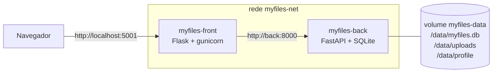

# Executando o MyFiles com Docker: passo a passo

Este guia sobe a aplicação completa com **dois containers**:

| Container | Serviço no Compose | Conteúdo | Porta no computador |
|---|---|---|---|
| `myfiles-back` | `back` | API FastAPI **+ banco SQLite** + arquivos enviados | `127.0.0.1:8000` (só Swagger) |
| `myfiles-front` | `front` | Interface web Flask (gunicorn) | `5001` |



O banco é um arquivo SQLite (`/data/myfiles.db`) dentro do container do
backend. A pasta `/data` é um **volume**, então banco e arquivos sobrevivem a
`docker compose down`, à reconstrução das imagens e à reinicialização da máquina.

---

## Passo 1: instalar o Docker

É preciso ter o **Docker Engine** com o plugin **Compose v2** (comando
`docker compose`, com espaço).

- **Windows e macOS:** instale o [Docker Desktop](https://docs.docker.com/desktop/).
- **Linux:** siga o guia oficial para a sua distribuição em
  https://docs.docker.com/engine/install/. No Ubuntu, a forma mais curta é:

  ```bash
  sudo apt update
  sudo apt install -y docker.io docker-compose-v2
  sudo usermod -aG docker $USER     # permite usar docker sem sudo
  newgrp docker                     # ou saia e entre de novo na sessão
  ```

Confira a instalação:

```bash
docker --version
docker compose version
docker run --rm hello-world
```

## Passo 2: obter o código

```bash
git clone https://github.com/armandossrecife/myfiles.git
cd myfiles
```

Se você recebeu o projeto em `.zip`, descompacte e entre na pasta: `unzip myfiles-refatorado.zip && cd myfiles`.

Todos os comandos a seguir são executados **na raiz do repositório**, onde
está o `docker-compose.yml`.

## Passo 3: configurar as variáveis (`.env`)

```bash
cp .env.example .env
```

Abra o `.env` e ajuste o necessário:

| Variável | Para que serve | O que fazer |
|---|---|---|
| `MYFILES_SECRET_KEY` | Assina os tokens do backend | Troque por um valor aleatório |
| `MY_SECRET_KEY` | Assina o cookie de sessão do frontend | Troque por outro valor aleatório |
| `MYFILES_ADMIN_USERNAME`, `_PASSWORD`, `_EMAIL` | Usuário criado na primeira subida | Ajuste ou apague as três linhas |
| `FRONT_PORT` | Porta da aplicação no seu computador | `5001` (ou `80` num servidor) |
| `BACK_PORT` | Porta do Swagger (acessível só pela própria máquina) | `8000` |
| `MYFILES_MAX_UPLOAD_MB` | Limite por arquivo, aplicado nos dois containers | `50` |

Para gerar as chaves:

```bash
python3 -c "import secrets; print(secrets.token_urlsafe(48))"
```

O `.env` é opcional: sem ele, o Compose usa valores de desenvolvimento. Ele
está no `.gitignore` e no `.dockerignore`, então não vai para o Git nem para
as imagens.

## Passo 4: construir as imagens e subir os containers

```bash
docker compose up --build -d
```

O que acontece:

1. As imagens `myfiles-back` e `myfiles-front` são construídas a partir de
   `docker/back.dockerfile` e `docker/front.dockerfile`. A primeira vez leva
   alguns minutos; nas próximas, o cache das dependências deixa tudo mais rápido.
2. O volume `myfiles_myfiles-data` e a rede `myfiles_myfiles-net` são criados.
3. O `back` inicia, cria as tabelas e o usuário inicial (se configurado).
4. O `front` **espera o `back` ficar saudável** (`/health` respondendo) e só
   então inicia.

## Passo 5: verificar se está tudo de pé

```bash
docker compose ps
```

Os dois serviços devem aparecer com estado `running` e `(healthy)`:

```
NAME            SERVICE   STATUS                    PORTS
myfiles-back    back      Up 30 seconds (healthy)   127.0.0.1:8000->8000/tcp
myfiles-front   front     Up 20 seconds (healthy)   0.0.0.0:5001->5001/tcp
```

Outras verificações:

```bash
curl http://localhost:5001/health      # {"status":"ok"}
curl http://localhost:8000/health      # {"status":"ok"}
docker compose logs back               # logs da API
docker compose logs -f front           # logs do frontend em tempo real (Ctrl+C sai)
```

## Passo 6: usar a aplicação

1. Abra **http://localhost:5001**.
2. Entre com o usuário inicial do `.env` (por exemplo `armando` / `armando123`)
   ou clique em **Criar conta**.
3. No menu: **Arquivos** (enviar e ver imagens JPG/PNG, vídeos MP4 e áudios
   MP3), **Anotações**, **Linha do tempo**, **Tarefas** e, no seu nome, o **Perfil**.

A documentação da API fica em **http://localhost:8000/docs**. Clique em
**Authorize** e informe usuário e senha para testar as rotas protegidas.

## Passo 7: operações do dia a dia

| Tarefa | Comando |
|---|---|
| Parar sem remover nada | `docker compose stop` |
| Iniciar de novo | `docker compose start` |
| Reiniciar um serviço | `docker compose restart front` |
| Remover os containers (**dados preservados**) | `docker compose down` |
| Aplicar mudanças no código | `docker compose up --build -d` |
| Ver logs | `docker compose logs -f` |
| Abrir um terminal no backend | `docker compose exec back bash` |
| Ver o uso de recursos | `docker stats myfiles-back myfiles-front` |

Para consultar o banco dentro do container (a imagem não tem o cliente
`sqlite3`, mas o Python tem o módulo):

```bash
docker compose exec back python -c "
import sqlite3
c = sqlite3.connect('/data/myfiles.db')
print(c.execute('select id, username, email from users').fetchall())
print(c.execute('select id, user_id, original_name, size from files').fetchall())"
```

## Passo 8: backup, restauração e limpeza dos dados

Todos os dados estão no volume `myfiles_myfiles-data`.

**Backup** (gera `myfiles-backup.tar.gz` na pasta atual):

```bash
docker compose stop back
docker run --rm -v myfiles_myfiles-data:/data -v "$PWD":/backup alpine \
  tar czf /backup/myfiles-backup.tar.gz -C /data .
docker compose start back
```

**Restauração:**

```bash
docker compose stop back
docker run --rm -v myfiles_myfiles-data:/data -v "$PWD":/backup alpine \
  sh -c "rm -rf /data/* && tar xzf /backup/myfiles-backup.tar.gz -C /data"
docker compose start back
```

**Apagar tudo e começar do zero** (containers, rede **e dados**):

```bash
docker compose down -v
```

## Passo 9 (opcional): executar em um servidor, como uma instância EC2

1. Instale o Docker no servidor (passo 1) e copie o projeto (passo 2).
2. No `.env`, troque as duas chaves secretas e use `FRONT_PORT=80`.
3. Rode `docker compose up --build -d`.
4. No grupo de segurança, libere **somente** a porta do frontend (80 ou 5001).
   A porta 8000 do backend é publicada apenas em `127.0.0.1` e não fica
   acessível de fora.
5. Acesse `http://<ip-publico-da-instancia>`.

Os containers usam `restart: unless-stopped`, então voltam sozinhos quando o
servidor reinicia.

## Solução de problemas

| Sintoma | Causa provável | Solução |
|---|---|---|
| `port is already allocated` | Porta 5001 ou 8000 em uso | Mude `FRONT_PORT`/`BACK_PORT` no `.env`. No macOS, a 5001 costuma estar ocupada pelo AirPlay. |
| `front` fica em `Created` ou `Waiting` | O `back` não ficou saudável | Veja `docker compose logs back` |
| Página "Erro 503: Não foi possível conectar ao backend" | `back` parado ou reiniciando | Rode `docker compose ps` e `docker compose start back` |
| Fui deslogado depois de reiniciar | `MY_SECRET_KEY` ou `MYFILES_SECRET_KEY` mudou | Comportamento esperado: entre de novo |
| "Sua sessão expirou" depois de um tempo | Token do backend expirou (padrão: 30 min) | Ajuste `MYFILES_TOKEN_EXPIRE_MINUTES` |
| "Arquivo maior que o limite" | Acima de `MYFILES_MAX_UPLOAD_MB` | Aumente no `.env` e rode `docker compose up -d` |
| `Permission denied` em `/data` | Volume trocado por uma pasta do computador (bind mount) | Use o volume nomeado ou dê a pasta ao uid 10001: `sudo chown -R 10001 ./pasta` |
| `permission denied ... docker.sock` | Usuário fora do grupo `docker` | Rode `sudo usermod -aG docker $USER` e entre de novo na sessão |
| Mudanças no código não aparecem | Imagem antiga | Rode `docker compose up --build -d` |

## Referência dos arquivos Docker

| Arquivo | Função |
|---|---|
| `docker-compose.yml` | Define os serviços `back` e `front`, o volume, a rede, as portas, os healthchecks e a ordem de inicialização |
| `docker/back.dockerfile` | Imagem do backend e do banco: Python 3.12 slim, usuário sem root, volume `/data`, `HEALTHCHECK` |
| `docker/front.dockerfile` | Imagem do frontend: Python 3.12 slim, gunicorn, usuário sem root, `HEALTHCHECK` |
| `.dockerignore` | Mantém fora das imagens testes, ambientes virtuais, dados locais, `.git` e `.env` |
| `.env.example` | Modelo das variáveis de configuração |
